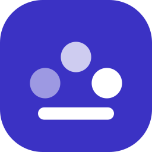
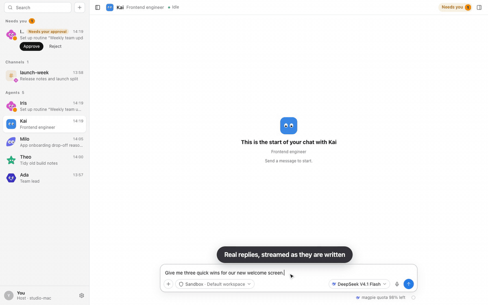

<p align="center">
  
</p>

<h1 align="center">Crewbase</h1>

<p align="center">
  A local-first, model-agnostic workspace for a crew of AI agents.<br>
  Bring the models you already use — API keys, a magpie gateway or local models — and keep every action auditable.
</p>

<p align="center">
  <a href="docs/media/crewbase-intro.mp4"></a>
  <br>
  <sub><a href="docs/media/crewbase-intro.mp4">▶ Watch the 70-second intro (MP4)</a></sub>
</p>

<p align="center">
  <a href="https://github.com/hedeqiang/crewbase/releases/latest"></a>
  <a href="https://github.com/hedeqiang/crewbase/actions/workflows/ci.yml"></a>
  <a href="LICENSE"></a>
  <a href="https://awesomemygo.dev/ai"></a>
</p>

<p align="center"><b>English</b> · <a href="README.zh-CN.md">简体中文</a></p>

---

Crewbase runs a team of agents on your own machine or server. Each agent has its own workspace, models and permissions; they hand work to each other in channels, delegate to sub-agents, and stop to ask you before anything risky. Everything they do is written to a local, append-only log.

> **Status:** early preview (0.1). Interfaces and storage formats may still change between minor versions.

## Highlights

- **Any model.** Native Anthropic, OpenAI, Gemini, DeepSeek, xAI, Kimi, Zhipu, MiniMax, Qwen and Volcengine providers, any OpenAI-compatible endpoint, the [magpie](https://github.com/yetone/magpie) gateway, and local models (Ollama, LM Studio). Routes by task type and fails over to the next model.
- **A crew, not a chatbot.** Channels with a single owner and explicit handover, sub-agent delegation, workflows on a visual canvas, and a shared task board (dependency graph) per delegation tree. A blank **New chat** (⌘N) still has every tool.
- **Code that is reviewed before it lands.** In a Git project, every sub-agent that writes gets its own worktree and branch, so parallel agents never overwrite each other. Agents review each other's branches with line comments and bounded fix rounds; nobody approves their own work, merges are previewed without touching a working tree, frozen lines stay frozen, and pushes ask first. With GitHub: open pull requests from reviewed branches, publish reviews on them, merge when CI is green, get a fix round when it is red — and review pull requests from forks without ever running their code ([details](docs/git.md)).
- **Webhooks in and out.** GitHub, GitLab, Sentry, Linear and Stripe events are verified, filtered and handed to channels, routines or workflows (even on a laptop behind NAT, through the relay); what happens here — a workflow finished, a routine found something, an approval is waiting — goes out signed, with retries ([details](docs/webhooks.md)).
- **Safe by default.** Three run modes — read-only, sandbox (Seatbelt on macOS, bubblewrap on Linux, Docker elsewhere) and host. A rules engine and approvals gate pushes, deletes, publishing and payments; secrets live in an encrypted vault in the data folder and are redacted from logs; a hash-chained audit log records who approved what.
- **Tools that do real work.** Shell and files in the workspace, a per-agent Chrome you can take over at any time, MCP servers (including OAuth and resources/prompts), skills, long-term memory, and attachments (images, PDF, Office) loaded natively for models that can read them.
- **A shared library and schedules.** Files uploaded in conversations, images and videos agents generate, and documents they save land in a per-team library with full-text search (Chinese too), versions and private items; every agent can search it. Ask an agent for something recurring ("every morning at 8, check …") and it sets up a routine after you confirm.
- **Docs written with your agents.** Connect a self-hosted [Open Agent Docs](https://github.com/kadaliao/open-agent-docs) server: each agent gets its own identity there, and @mentioning one in a comment gives it the task ([details](docs/agentdocs.md)).
- **Artifacts you edit, not just read.** With [Open Artifact](https://github.com/JimLiu/open-artifact) on, agents make slide decks, designs, whiteboards, sheets, dashboards, docs and short films as folders in their workspace; they open in the 预览 panel, where you retype, comment and export, and what you ask from the page comes back to the conversation that made it ([details](docs/open-artifact.md)).
- **DeepSeek tool APIs for any model.** With a DeepSeek key, every agent gets `web_search`, `web_fetch` and `ocr_file`; scanned PDFs and images are OCR'd for text-only models; dictation and read-aloud use DeepSeek ASR / TTS.
- **Plugins all the way down.** The kernel is a plugin host: built-in Go plugins, out-of-process plugins in Go, TypeScript or Python, sandboxed **WebAssembly** hooks, and declarative UI slots. Marketplace packages are checksum-pinned and publisher-signed.
- **Reach it from anywhere — with zero inbound ports.** Pair a phone through an end-to-end encrypted relay (installable PWA for approvals and chat), or talk to your crew from Slack, Telegram, Discord, Feishu and Lark.
- **Desktop and server.** A native desktop app for macOS, Windows and Linux with automatic updates, or a hardened headless server (systemd or Docker).

## Install

### Desktop app

**macOS** (recommended — installs to `/Applications` after checking the update signature):

```sh
curl -fsSL https://github.com/hedeqiang/crewbase/releases/latest/download/install.sh | sh
```

Or with [Homebrew](https://brew.sh):

```sh
brew install --cask hedeqiang/tap/crewbase
```

You can also download `crewbase-<version>.dmg` — a universal app that runs natively on Apple silicon and Intel — from [Releases](https://github.com/hedeqiang/crewbase/releases/latest). The app is not notarized by Apple yet, so the first launch of a browser-downloaded copy has to be allowed in **System Settings › Privacy & Security › Open Anyway**. The install script and Homebrew avoid this.

**Windows:** download `crewbase-setup-<version>-amd64.exe` (or `arm64`) from [Releases](https://github.com/hedeqiang/crewbase/releases/latest). The installer is unsigned for now; choose *More info › Run anyway* in SmartScreen.

**Linux:** use the same `install.sh` (installs to `~/.local`), or the `.deb` / `.rpm` packages. Requires WebKitGTK 4.1.

Installed apps update themselves (or check from the app menu: **检查更新…**). The interface is currently in Chinese; English is available in Settings.

### Server

```sh
docker pull ghcr.io/hedeqiang/crewbase          # distroless; :chromium includes a browser
```

For a hardened setup use [`deploy/docker-compose.yml`](deploy/docker-compose.yml) or the systemd installer [`deploy/install-server.sh`](deploy/install-server.sh) — see the [deployment guide](docs/deploy.md). The gateway only listens on `127.0.0.1`; reach it over SSH, Tailscale or the relay.

Standalone `crewd`, `crew` and `crew-relay` binaries for macOS, Linux and Windows are attached to every release as `crewbase-cli-<version>-<os>-<arch>`.

## Getting started

1. Open Crewbase. A running magpie, Ollama or LM Studio is picked up automatically; otherwise add a provider in **Settings › Models** (keys go to the vault).
2. Press **⌘N** for a blank chat, or **⇧⌘N** to create an agent from a template with its own instructions, workspace and run mode.
3. Give it work. Risky steps show up as approval cards; the right panel shows its task board and files.

The `crew` CLI talks to the same daemon:

```sh
crew agents                     # list agents
crew chat <agent> "fix the failing test"   # send and stream the turn
crew approvals                  # pending approvals; crew approve|reject <callId>
crew plugin market              # browse plugins; crew plugin install <name>
crew plugin new my-tool --lang ts   # scaffold a plugin; crew dev <dir> hot-reloads it
crew doctor                     # check the installation
```

## Build from source

Requires Go 1.27, Node 22 and pnpm 10.

```sh
git clone https://github.com/hedeqiang/crewbase.git && cd crewbase
make build          # web UI + bin/crewd + bin/crew
make desktop        # Crewbase.app / installer in apps/desktop/build
make check          # go vet + race tests
./bin/crewd         # daemon on 127.0.0.1:7788 (token in ~/.crewbase/token)
```

`go run ./apps/desktop` starts the desktop shell in development mode. Live tests against real models are behind a build tag: `go test -tags live ./test/live`.

## Repository layout

| Path | Contents |
|---|---|
| `kernel/` | Plugin host: services, events, scopes, effects, profiles |
| `core/` | Agents, agent loop, sessions, tools, model interfaces |
| `capabilities/` | Interfaces with swappable providers (approval, browser, credentials, sandbox, …) |
| `providers/` | Implementations: model adapters, sandboxes, browser, IM gateways |
| `features/` | Product features as plugins (channels, workflows, MCP, relay, members, …) |
| `bridge/` | Out-of-process and WebAssembly plugin runtimes |
| `apps/` | `crewd`, `crew`, `crew-relay`, the desktop shell and the web UI |
| `sdk/`, `examples/plugins/` | Plugin SDKs (Go, TypeScript, Python) and examples |
| `deploy/` | Docker Compose, systemd installer, cloud templates |

## Documentation

The design documents are written in Chinese; English versions will follow.

- [Product requirements](docs/01-product-requirements.md) · [UX design](docs/03-ux-design.md) · [Roadmap](docs/07-roadmap.md)
- [Architecture](docs/04-architecture.md) · [Plugin system](docs/05-plugin-system.md) · [Security model](docs/06-security-model.md)
- [Desktop app](docs/desktop.md) · [Deployment](docs/deploy.md) · [Releasing](docs/release.md)
- Features: [Previews](docs/previews.md) · [Computer use](docs/computer-use.md) · [Open Agent Docs](docs/agentdocs.md) · [Open Artifact](docs/open-artifact.md)

## Security

Crewbase runs code and calls services on your behalf, so its defaults are conservative: agents start in the sandbox, nothing listens beyond loopback, and payments can never be approved remotely. Please report vulnerabilities privately through [GitHub security advisories](https://github.com/hedeqiang/crewbase/security/advisories/new) rather than public issues. See the [security model](docs/06-security-model.md).

## Contributing

Issues and pull requests are welcome. Run `make check` and `pnpm build` in `apps/web` before sending a change; CI runs the same checks on Linux and macOS.

## License

[MIT](LICENSE).
