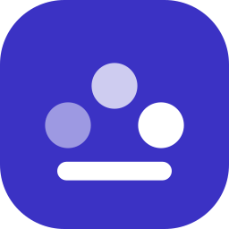
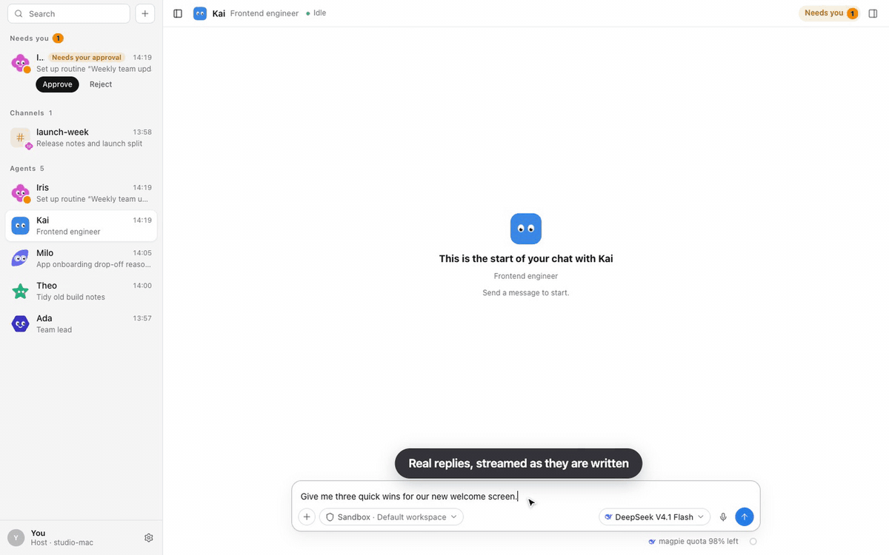

<p align="center">
  
</p>

<h1 align="center">Crewbase</h1>

<p align="center">
  本地优先、不绑定模型的多 Agent 协作工作台。<br>
  接上你已有的模型（API Key、magpie 网关或本地模型），每一步操作都可审计。
</p>

<p align="center">
  <a href="docs/media/crewbase-intro.mp4"></a>
  <br>
  <sub><a href="docs/media/crewbase-intro.mp4">▶ 观看 70 秒介绍视频（MP4）</a></sub>
</p>

<p align="center">
  <a href="https://github.com/hedeqiang/crewbase/releases/latest"></a>
  <a href="https://github.com/hedeqiang/crewbase/actions/workflows/ci.yml"></a>
  <a href="LICENSE"></a>
  <a href="https://awesomemygo.dev/ai"></a>
</p>

<p align="center"><a href="README.md">English</a> · <b>简体中文</b></p>

---

Crewbase 在你自己的电脑或服务器上运行一支 Agent 团队。每个 Agent 有自己的工作区、模型和权限；它们在频道里交接工作、把任务委派给子 Agent，遇到有风险的操作会先停下来问你。所做的一切都写入本地只追加的日志。

> **状态：** 早期预览版（0.1）。小版本之间接口与存储格式仍可能调整。

## 亮点

- **任意模型。** 原生接入 Anthropic、OpenAI、Gemini、DeepSeek、xAI、Kimi、智谱、MiniMax、通义千问、火山引擎，以及任何 OpenAI 兼容接口、[magpie](https://github.com/yetone/magpie) 网关、本地模型（Ollama、LM Studio）。按任务类型路由，失败自动切换到下一个模型。
- **是团队，不只是聊天。** 频道单一负责人与显式交接、子 Agent 委派、可视化画布编排工作流，每棵委派树共享一块任务板（依赖图）。空白的**新对话**（⌘N）同样能使用全部工具。
- **代码先评审再合入。** 在 Git 项目里，每个要写代码的子 Agent 都有自己的工作树和分支，并行干活互不覆盖。Agent 之间用行评论互相评审、有上限地多轮返修；谁也不能批准自己（或自己子 Agent）的工作，合入前先预览且不碰任何工作区，冻结的代码行改不动，推送前都会先问你（[详情](docs/git.md)）。
- **Webhook 进出。** GitHub、GitLab、Sentry、Linear、Stripe 的事件验签、过滤后交给频道、例行巡检或工作流（没有公网地址的电脑也能经中继接收）；这里发生的事——工作流完成、巡检发现问题、等待审批——带签名推送出去，失败自动重试（[详情](docs/webhooks.md)）。
- **默认安全。** 三档运行模式：只读、沙箱（macOS 用 Seatbelt，Linux 用 bubblewrap，其他平台用 Docker）、本机。规则引擎与审批拦住推送、删除、对外发布和支付；密钥加密保存在数据目录的保管库里，并在日志中脱敏；哈希链审计日志记录谁批准了什么。
- **真能干活的工具。** 工作区里的命令与文件、每个 Agent 一个可随时接管的 Chrome、MCP 服务器（支持 OAuth 与 resources / prompts）、技能、长期记忆，以及附件（图片、PDF、Office）——能直接读的模型收到原文件。
- **文档库与定时。** 对话里上传的文件、Agent 生成的图片和视频、Agent 保存的文档，按团队归档进文档库：全文搜索（中文也能搜）、历史版本、可设为私有，每个 Agent 都能搜到。在对话里让 Agent 做周期性的事（「每天早上 8 点检查……」），你确认后它会建一个例行巡检。
- **和 Agent 一起写文档。** 连接自己部署的 [Open Agent Docs](https://github.com/kadaliao/open-agent-docs)：每个 Agent 在里面有自己的身份，在评论里 @ 它就会收到任务（[说明](docs/agentdocs.md)）。
- **DeepSeek 工具 API，任何模型可用。** 配好 DeepSeek Key 后，所有 Agent 都能用 `web_search`、`web_fetch`、`ocr_file`；扫描版 PDF 与图片会为不能看图的模型做 OCR；语音听写与朗读走 DeepSeek ASR / TTS。
- **一切皆插件。** 内核是插件宿主：内置 Go 插件、Go / TypeScript / Python 进程外插件、沙箱化的 **WebAssembly** 钩子，以及声明式界面插槽。插件市场的包固定校验和并带发布者签名。
- **随处可达，零入站端口。** 通过端到端加密的中继配对手机（可安装的 PWA，用于审批和对话），或在 Slack、Telegram、Discord、飞书、Lark 里和团队对话。
- **桌面与服务端。** macOS、Windows、Linux 原生桌面应用，自动更新；或加固的无界面服务端（systemd / Docker）。

## 安装

### 桌面应用

**macOS**（推荐：校验更新签名后装到 `/Applications`）：

```sh
curl -fsSL https://github.com/hedeqiang/crewbase/releases/latest/download/install.sh | sh
```

或者用 [Homebrew](https://brew.sh)：

```sh
brew install --cask hedeqiang/tap/crewbase
```

也可以在 [Releases](https://github.com/hedeqiang/crewbase/releases/latest) 下载 `crewbase-<版本>.dmg`（通用版，Apple 芯片与 Intel 都原生运行）。应用暂未经 Apple 公证，浏览器下载的副本首次打开需要在 **系统设置 › 隐私与安全性 › 仍要打开** 中允许；用上面的安装脚本或 Homebrew 则不会遇到。

**Windows：** 在 [Releases](https://github.com/hedeqiang/crewbase/releases/latest) 下载 `crewbase-setup-<版本>-amd64.exe`（或 `arm64`）。安装程序暂未签名，SmartScreen 提示时选择「更多信息 › 仍要运行」。

**Linux：** 同样使用 `install.sh`（装到 `~/.local`），或使用 `.deb` / `.rpm` 包。需要 WebKitGTK 4.1。

已安装的应用会自动更新（也可以在应用菜单点 **检查更新…**）。界面默认中文，可在设置中切换为英文。

### 服务端

```sh
docker pull ghcr.io/hedeqiang/crewbase          # distroless；:chromium 标签自带浏览器
```

加固部署请使用 [`deploy/docker-compose.yml`](deploy/docker-compose.yml) 或 systemd 安装脚本 [`deploy/install-server.sh`](deploy/install-server.sh)，详见[部署指南](docs/deploy.md)。网关只监听 `127.0.0.1`，通过 SSH、Tailscale 或中继访问。

每个版本都附带 macOS、Linux、Windows 的独立 `crewd`、`crew`、`crew-relay` 二进制（`crewbase-cli-<版本>-<系统>-<架构>`）。

## 快速开始

1. 打开 Crewbase。正在运行的 magpie、Ollama 或 LM Studio 会被自动识别；否则在 **设置 › 模型** 添加提供方（Key 存入保管库）。
2. 按 **⌘N** 开一个空白对话，或按 **⇧⌘N** 从模板新建 Agent，设定它的指令、工作区和运行模式。
3. 给它派活。有风险的步骤会弹出审批卡片；右侧面板显示任务板和文件。

`crew` 命令行连接同一个守护进程：

```sh
crew agents                     # 列出 Agent
crew chat <agent> "修复失败的测试"   # 发送并实时显示这一轮
crew approvals                  # 待审批；crew approve|reject <callId>
crew plugin market              # 浏览插件；crew plugin install <name>
crew plugin new my-tool --lang ts   # 生成插件骨架；crew dev <dir> 热重载
crew doctor                     # 检查安装
```

## 从源码构建

需要 Go 1.27、Node 22 和 pnpm 10。

```sh
git clone https://github.com/hedeqiang/crewbase.git && cd crewbase
make build          # 网页界面 + bin/crewd + bin/crew
make desktop        # Crewbase.app / 安装包，输出到 apps/desktop/build
make check          # go vet + race 测试
./bin/crewd         # 守护进程，监听 127.0.0.1:7788（令牌在 ~/.crewbase/token）
```

`go run ./apps/desktop` 以开发模式启动桌面壳。对真实模型的联调测试需要构建标签：`go test -tags live ./test/live`。

## 目录结构

| 路径 | 内容 |
|---|---|
| `kernel/` | 插件宿主：服务、事件、作用域、副作用、Profile |
| `core/` | Agent、Agent 循环、会话、工具、模型接口 |
| `capabilities/` | 可替换提供方的能力接口（审批、浏览器、凭证、沙箱等） |
| `providers/` | 具体实现：模型适配器、沙箱、浏览器、IM 网关 |
| `features/` | 以插件形式实现的产品功能（频道、工作流、MCP、中继、成员等） |
| `bridge/` | 进程外与 WebAssembly 插件运行时 |
| `apps/` | `crewd`、`crew`、`crew-relay`、桌面壳与网页界面 |
| `sdk/`、`examples/plugins/` | 插件 SDK（Go、TypeScript、Python）与示例 |
| `deploy/` | Docker Compose、systemd 安装脚本、云部署模板 |

## 文档

- [产品需求](docs/01-product-requirements.md) · [交互设计](docs/03-ux-design.md) · [路线图](docs/07-roadmap.md)
- [技术架构](docs/04-architecture.md) · [插件系统](docs/05-plugin-system.md) · [安全模型](docs/06-security-model.md)
- [桌面应用](docs/desktop.md) · [部署](docs/deploy.md) · [发版](docs/release.md)
- 功能说明：[预览](docs/previews.md) · [电脑操作](docs/computer-use.md) · [Open Agent Docs](docs/agentdocs.md)

完整目录见 [docs/README.md](docs/README.md)。

## 安全

Crewbase 会代你执行代码、调用服务，所以默认设置很保守：Agent 默认在沙箱中运行，除回环地址外不监听任何端口，支付永远不能远程批准。发现漏洞请通过 [GitHub 安全公告](https://github.com/hedeqiang/crewbase/security/advisories/new) 私下报告，不要公开提 issue。详见[安全模型](docs/06-security-model.md)。

## 参与贡献

欢迎提 issue 和 PR。提交前请运行 `make check`，并在 `apps/web` 下运行 `pnpm build`；CI 会在 Linux 与 macOS 上跑同样的检查。

## 许可证

[MIT](LICENSE)。
