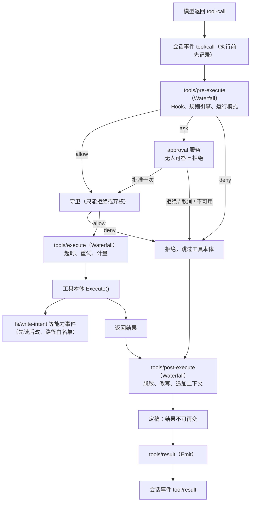

# 插件系统设计

> 本文是 Crewbase 技术设计的核心。它借鉴 DeepSeek Harness（MIT）基于 Cordis 的「一切皆插件」架构，并按我们的 Go 技术栈和多 Agent 场景重新设计。Harness 原始概念与出处见 [参考笔记](references/deepseek-harness.md)；关键取舍记录在 [ADR-0001](decisions/0001-plugin-first-kernel.md) 与 [ADR-0002](decisions/0002-plugin-runtime-tiers.md)。

## 1. 目标

1. **没有特权内核**。产品的每一部分都是插件：模型适配器、工具注册表、会话日志、沙箱、审批策略、频道协作，以及 Agent 循环本身。扩展 Crewbase 的方式是把插件挂到其他插件旁边，而不是给内核打补丁。
2. **注册即副作用，卸载即撤销**。插件注册的工具、提示词片段、事件监听器、界面组件，都会在插件卸载时自动撤销。这是热重载、按需启停和安全吊销的基础。
3. **换提供方就能改变整个产品**。把 Shell 提供方从「本地」换成「远程容器」，所有用到 Shell 的工具一起迁移，不需要分叉代码。
4. **第三方插件不能拖垮宿主**。社区插件默认在独立进程或 WASM 中运行，声明权限后由用户批准启用。

## 2. 七个核心概念

| 概念 | 一句话 | Harness 对应 |
|---|---|---|
| 插件（Plugin） | 声明依赖，然后向上下文注册服务、事件监听和副作用的单元 | Cordis plugin：`inject` + `apply(ctx)` |
| 上下文（Context） | 服务的容器；每个服务占据一个稳定的键，如 `tools`、`llm`、`sessions` | `ctx.<key>` |
| 依赖注入（Inject） | 插件声明需要哪些服务，全部就绪后才启动；缺失时保持 PENDING | `inject` 与 PENDING 状态 |
| 类型化事件（Event） | 插件之间通过事件通信，每个事件有固定的分发模式 | `emit` / `waterfall` / `parallel` / `serial` / `bail` |
| 副作用（Effect） | 所有注册都返回一个撤销函数，插件卸载时按逆序执行 | `ctx.effect()` 与 disposer |
| 作用域（Scope） | 注册要么全局可见，要么只属于某一个 Agent | agent scope、shadowing、restriction |
| 能力（Capability） | 一项可替换能力由「定义 + 提供方 + 消费方」三种角色组成 | capability seam |

### 2.1 插件

Go 中的最小插件：

```go
package greet

import (
    "context"
    "github.com/hedeqiang/crewbase/kernel"
    "github.com/hedeqiang/crewbase/core/tools"
)

var Plugin = kernel.Define(kernel.Spec{
    Name:   "greet-tool",
    Inject: []string{"tools"},            // 等待 tools 服务就绪
    Apply: func(ctx *kernel.Context) error {
        reg := kernel.Use[*tools.Registry](ctx, "tools")
        // Register 返回的撤销函数自动挂到 ctx，插件卸载时注销工具
        reg.Register(ctx, tools.Define(tools.Spec{
            Name:        "greet",
            Description: "Greet the named person.",
            Params:      tools.Object{"name": tools.String().Required()},
            Execute: func(c context.Context, call tools.Call) (tools.Result, error) {
                return tools.Text("Hello, " + call.String("name") + "!"), nil
            },
        }))
        return nil
    },
})
```

一个独立的观察插件，不需要知道 `greet-tool` 存在：

```go
var Logger = kernel.Define(kernel.Spec{
    Name:   "tool-logger",
    Inject: []string{"tools"},
    Apply: func(ctx *kernel.Context) error {
        tools.OnResult.Listen(ctx, func(exec tools.Execution, r tools.Result) {
            ctx.Log().Info("tool done", "name", exec.Name, "error", r.IsError)
        })
        return nil
    },
})
```

### 2.2 上下文与服务

- 服务通过**键**查找，而不是导入具体实现：`kernel.Use[*tools.Registry](ctx, "tools")`。
- 同一个键在同一作用域内只有一个提供方。需要两套不同配置时，用**隔离组**（`isolate`）给一组插件单独的服务实例，例如两个工作区各有一个配置不同的 `shell`。
- 服务本身也是插件：`tools` 服务由 `core/tools` 插件提供，可以被替换。

### 2.3 依赖与 PENDING

- 插件的 `Inject` 列表全部就绪后才执行 `Apply`；任一依赖消失，插件自动卸载，依赖恢复后自动重新加载。
- 依赖无人提供时，插件保持 **PENDING**。这不是错误，因为提供方可能稍后才挂载。
- 诊断命令：`crew plugins --state pending` 列出所有 PENDING 插件及其缺失的服务；设置页「插件」卡片同样显示。

### 2.4 事件与五种分发模式

事件名和载荷类型在定义处固定，分发模式是事件公开约定的一部分，只能用对应的方法分发。

| 模式 | 等待？ | 顺序 | 返回值 | 典型用途 |
|---|---|---|---|---|
| `Emit` | 否 | 按注册顺序观察 | 无 | 通知：`tools/result`、`session/event` |
| `Waterfall` | 否 | 环绕中间件，每层调用 `next()` | 有 | 拦截与改写：`tools/pre-execute`、`agent/pre-step`、`llm/stream` |
| `Parallel` | 是 | 并行扇出 | 无 | 广播到多个外部网关 |
| `Serial` | 是 | 按序执行 | 有 | 有序收尾：`agent/turn-stopping` |
| `Bail` | 否 | 按序，遇到第一个非空返回停止 | 有 | 「谁能处理」：选择审批人、选择浏览器提供方 |

**Waterfall 语义**（最重要）：监听器收到 `(args..., next)`。调用 `next()` 执行下游；可以包装下游返回值后再返回；不调用 `next()` 直接返回即为**短路**。

- 拥有决策权的策略监听器（如规则引擎判定 Block）可以短路。
- 只做标注或观察的监听器必须调用 `next()`。
- 只有必须先于普通注册运行时才使用 `Prepend`。

```go
// 规则引擎：命中 Block 时短路，不调用 next
tools.PreExecute.Use(ctx, func(c context.Context, d *tools.Decision, next tools.Next) (*tools.Decision, error) {
    switch rules.Match(d.Call) {
    case rules.Block:
        return d.Deny("blocked by rule: " + d.Call.Name), nil
    case rules.Ask:
        d.RequireApproval(rules.Reason(d.Call))
    }
    return next(c, d)
})
```

### 2.5 副作用与撤销

- 每个注册（工具、提示词片段、适配器、监听器、界面组件、定时器、子进程）都返回撤销函数，由 `ctx` 记录。
- 插件卸载时按**注册的逆序**撤销。有顺序要求的资源放进同一个 `ctx.Effect(func() (dispose func()))` 中。
- 插件的 goroutine 必须使用 `ctx.Go(...)` 启动，卸载时会取消其 `context.Context` 并等待退出。
- 静态检查：CI 中运行 `crew lint plugins`，检测未通过 `ctx` 注册的全局副作用（例如直接写包级变量、裸 `go` 语句）。

### 2.6 作用域：全局与每个 Agent

多 Agent 是我们和 Harness 最大的场景差异，作用域是承载它的机制。

- 只有两层：**全局**（对所有 Agent 可见）和**Agent 作用域**（只属于一个 Agent）。结构是扁平的，Agent 作用域的注册不会向下继承给子 Agent。
- 每个 Agent 有自己的 `agent.Ctx`。通过它注册的内容，可见范围和生命周期都绑定在这个 Agent 上，Agent 被删除时自动撤销。
- **覆盖（shadowing）**：Agent 作用域内的同名工具、提示词片段、变量替换全局版本。这是「每个 Agent 有自己的人设和工具变体」的实现方式。
- **限制（restriction）**：`tools.Restrict` 为一个 Agent 过滤全局工具集合，多个限制取交集。被过滤掉的工具既不出现在提示词中，也拒绝执行，与不存在无法区分。只读调研模式就是一个限制。
- **组装窗口（setup window）**：创建 Agent 时有一个专门的时机用于注册它的私有工具和提示词；此时 Agent 尚未发布，不会收到任何输入。
- **父子关系是数据**：子 Agent 的 `parentSession`、委派深度等以数据记录，用于审计和展示，从不影响可见性。
- **作用域分发**：关于某个 Agent 活动的事件以该 Agent 为载体分发，只有全局监听器和该 Agent 自己的监听器会收到。关于注册表本身的事件（如「新增了一个工具」）不过滤。

### 2.7 能力：定义 + 提供方 + 消费方

一项能力由三种角色组成，缺一不可；单一角色不叫能力。

| 角色 | 职责 | 例：Shell |
|---|---|---|
| 定义（Definition） | 拥有服务键和词汇类型，规定约定 | `shell` 服务，`ShellExecRequest` / `ShellRunResult` |
| 提供方（Provider） | 实现约定，可以有多个 | `shell-local`、`shell-docker`、`shell-ssh` |
| 消费方（Consumer） | 注入服务并使用，通常是面向模型的工具 | `tool-bash`、`tool-terminal` |

我们的能力清单（初版）：

| 能力键 | 定义 | 提供方（计划） | 主要消费方 |
|---|---|---|---|
| `llm` | 消息、流式块、适配器约定 | `llm-anthropic`、`llm-openai`、`llm-gemini`、`llm-deepseek`、`llm-ollama`、`llm-acp`（桥接 Claude Code / Codex / Gemini CLI） | Agent 循环 |
| `router` | 每个 Agent 的模型顺序、配额状态、切换决策 | `router-default`、`router-cost`（按任务分流） | Agent 循环、模型选择器 |
| `shell` / `subprocess` | 命令执行与进程管理 | 本地、Docker Rootless、SSH、云端容器 | `tool-bash`、MCP、CLI 桥接 |
| `fs` | 读写编辑、先读后改检查 | 本地、容器挂载、SSH | 文件工具、右侧面板「文件」 |
| `sandbox` | 把命令包装进受限环境 | `sandbox-none`、`sandbox-docker`、`sandbox-namespace`、`sandbox-seatbelt`（macOS） | `shell`、`subprocess` 的提供方 |
| `approval` | 一次性审批请求与结果 | 桌面弹卡、移动端推送、IM 网关 | 工具执行流水线 |
| `credentials` | 凭证引用解析，值不出服务 | macOS Keychain、Windows 凭据管理器、libsecret、Vault | 适配器、MCP、插件 |
| `browser` | 浏览器操作与接管 | Playwright/CDP 本地池、远程浏览器 | `tool-browser`、浏览器接管卡 |
| `subagent` | 启动子 Agent 并等待结果 | `subagent-local`（新建 Agent）、`subagent-acp`（把一个轮次交给外部 CLI） | 负责人 Agent、工作流 |
| `channel` | 频道、成员、负责人、交接 | `channel-local`、`channel-team`（多人同步） | 交接工具、对话界面 |
| `memory` | 长期记忆写入与检索 | `memory-markdown-sqlite` | `history_search`、提示词组装 |
| `compaction` | 上下文压缩 | `compaction-summary`、`compaction-local-model` | Agent 循环 |
| `schedule` / `webhook` | 定时与外部触发 | Cron、Webhook、IM 事件 | Routines、Workflows |
| `notify` | 把事件送到人 | 桌面通知、移动推送、Slack、Telegram、飞书 | 审批、晨报 |
| `persistence` | 会话日志存储 | JSONL、SQLite、S3 兼容（团队版） | 会话、审计 |

> 例子：`subagent-acp` 让「把一个轮次委派给 Claude Code」与「新建一个本地子 Agent」走同一个接口。Harness 文档明确提到其子 Agent 提供方「从新建子 agent 到把一个轮次委派给另一个产品」差异很大，但都在同一接口之后。这与我们的订阅复用目标完全契合。

## 3. 会话日志是唯一真源

- 会话是**仅追加**的事件日志。模型历史、界面、审计、fork、崩溃恢复都从日志投影得到。
- **模型可见即已记录**：每次模型请求都必须能从日志重建。插件要往模型上下文里加内容，必须通过会话事件或 `agent.Inject()`，不能在请求发出前偷偷改。
- 由此带来的三个产品能力：
  1. **无损模型切换**：新适配器从同一份日志重建请求，不需要「迁移上下文」。
  2. **可审计**：任何一次模型请求的输入都可以复现。
  3. **fork 与回放**：在任意轮次边界 fork 出新会话，例如「从交接前的状态重试」。
- 日志格式带版本号（`session.v1.jsonl`），升级时按相邻版本逐步迁移，已写入的文件从不改写。

## 4. Agent 循环

循环层级沿用 Harness 的定义：

| 层级 | 含义 |
|---|---|
| 步骤（Step） | 一次模型请求，加上它引发的工具执行 |
| 轮次（Turn） | 把一批已接收的输入处理完，包含零到多个步骤 |
| Round | 外层策略的一次迭代，如目标续跑的一轮、工作流的一步 |

一个轮次的事件流（简化）：

```text
turn/start
  领取输入 → 快照模型选择 → 组装提示词与工具 schema
  agent/pre-step        (Waterfall：接受 / 改写 / 拒绝本次输入)
  step/start
    agent/request       (Waterfall：调整请求参数，不改变模型选择)
    llm/stream          (Waterfall：流式块可被翻译、脱敏、计量)
    tool/call* → 工具执行流水线 → tool/result*
  step/end
  还有工具结果待发送或新输入到达 → 下一个步骤
  agent/turn-stopping   (Serial：收尾，可阻止停止)
turn/end
```

我们在此之上增加的扩展点：

| 事件 | 模式 | 用途 |
|---|---|---|
| `router/quota-exhausted` | Bail | 选择下一个可用模型；默认提供方按 Agent 的模型顺序 |
| `channel/handover` | Waterfall | 交接前检查（产物是否齐全、接收方是否空闲），可改写交接说明 |
| `channel/owner-changed` | Emit | 更新界面与通知 |
| `agent/queue-changed` | Emit | 队列插队、取消、暂停 |

Agent 循环本身是 `agent-loop` 插件提供的默认驱动器，可以整体替换，例如替换成「计划模式」驱动器或外部 ACP 驱动器。

## 5. 工具执行流水线

所有工具调用都经过同一条流水线，策略、钩子、沙箱、审批、审计都挂在上面，工具本身不需要知道它们。



要点：

- **执行前先记录 `tool/call`**，崩溃后能知道哪些调用没有结果，并补记「中断」。
- **规则引擎是 `tools/pre-execute` 的一个监听器**，不是流水线的一部分；可以被替换或叠加（例如企业 DLP 策略）。
- **守卫只能拒绝或弃权**，不能放行已被拒绝的调用，顺序不得被重排。路径越界、运行模式限制等硬约束放在守卫里。
- **审批结果是闭合集合**：`allowed-once | rejected | cancelled | unavailable`，只有 `allowed-once` 放行。没有应答方、应答方出错或返回非法值，都是 `unavailable`（关闭式失败）。
- **审批请求只带 `callId`，不复制参数**，审批卡直接挂在已流式显示的工具调用上；工具调用被取消时审批自动变为 `cancelled`。
- **「从不询问」在分发前强制执行**：审批策略为 `never` 时由审批服务自己拒绝，后注册的应答方（即使 `Prepend`）也无法绕过。
- **审计写不进日志，审批直接失败**：`approval/asked`、`approval/decided` 是会话事件，写入失败时不放行。
- **脱敏放在 `tools/post-execute`**，保证凭证不进入 `tool/result`，也就不会进入模型上下文和日志。

## 6. 配置：Profile、组合包与补丁

运行中的 Crewbase 是一棵插件树，由多层配置按序叠加而成。

| 层 | 说明 |
|---|---|
| 组合包（Bundle） | 一组插件条目及其配置的分发单位，例如 `base`（模型适配器、工具、持久化、沙箱、审批、凭证）、`desktop`、`server`、`acp`、`team` |
| Profile | 一个具名组装：列出叠加哪些组合包、安装了哪些第三方插件、用户自己的补丁。内置 `desktop`、`server`、`sdk`、`acp` |
| 补丁（Patch） | 按条目 `id` 替换整个配置、插入新条目或禁用条目 |

叠加顺序：Profile 中的组合包（按序）→ Profile 补丁 → 用户主目录补丁 → 命令行 `--patch`。

```yaml
# ~/.crewbase/profiles/desktop/crewbase.patch.yml
- id: sandbox
  name: '@crewbase/sandbox-docker'
  config:
    image: crewbase/sandbox:2026.11
    network: allowlist
    allow: ['registry.npmjs.org', 'pypi.org']
- id: notify-feishu
  name: '@community/notify-feishu'
  runtime: process          # 第三方插件在独立进程中运行
  permissions: [network:open.feishu.cn, credentials:feishu-bot]
- id: hmr
  disabled: true
```

- 每个条目都应带稳定的 `id`，否则每次编辑配置都会被当成「先删再加」而重新挂载。
- `crew --profile desktop --dump-config` 打印完整插件树，其中每一项都可以被补丁替换。
- 桌面端、无头服务器、SDK、ACP 服务器共用同一套插件，只是 Profile 不同。

## 7. 插件运行形态

Go 不适合在进程内动态加载和卸载代码（标准库 `plugin` 包不支持 Windows、不能卸载、要求编译版本完全一致）。因此我们分四档运行插件，详见 [ADR-0002](decisions/0002-plugin-runtime-tiers.md)。

| 档位 | 形态 | 适用 | 隔离 | 热重载 |
|---|---|---|---|---|
| 内置 | 编译进主程序，进程内运行 | 官方核心插件：Agent 循环、工具注册表、会话、路由、规则引擎 | 无 | 启停可以，替换代码需重启 |
| 进程外 | 独立子进程，通过 stdio 上的 JSON-RPC 与宿主通信；SDK 提供 Go / TypeScript / Python | 第三方工具、模型适配器、IM 网关、沙箱后端 | 进程 + 可选容器 | 重启子进程即可 |
| WASM | 在宿主内的 wazero 运行时中执行 | 轻量、高频的纯函数钩子：规则判定、脱敏、流式块转换 | 内存隔离，无默认系统调用 | 支持 |
| 内容型 | MCP 服务器、技能（`SKILL.md` 文件夹）、角色模板 | 外部服务连接、可复用的任务方法 | 由 `shell` / `sandbox` 能力托管 | 支持 |

**进程外插件的桥接**：宿主中的代理插件替外部进程向 `ctx` 注册服务、工具和监听器，并记录撤销函数。外部进程退出时，代理插件卸载，所有注册一并撤销。对外部插件开放的 Waterfall 事件有超时（默认 2 秒），超时视为「调用 `next()` 不做改动」，防止外部插件阻塞流水线。

**权限声明**：进程外和 WASM 插件必须在清单中声明需要的服务和权限（文件路径、网络域名、凭证引用、子进程），宿主只向其暴露声明过且经用户批准的服务。

```toml
# crewbase-plugin.toml
name = "notify-feishu"
version = "0.3.1"
runtime = "process"
entry = ["node", "dist/index.js"]

[inject]
services = ["notify", "credentials"]

[permissions]
network = ["open.feishu.cn"]
credentials = ["feishu-bot"]
```

## 8. 界面扩展

桌面端界面同样由插件组成（借鉴 Harness 的 slots 与 client modules）。

| 插槽 | 用途 | 例子 |
|---|---|---|
| `conversation.node` | 对话中的自定义卡片，按会话事件类型渲染 | 审批卡、浏览器接管卡、部署结果卡 |
| `sidebar-right.tab` | 右侧面板标签页 | 任务、文件、Agent 设置、PR 状态 |
| `settings.card` | 设置页卡片 | 模型提供方配置、IM 网关配置 |
| `composer.action` | 输入框按钮 | 权限下拉、模型选择器、语音、添加附件 |
| `settings.section` | 设置页的分区 | 自动化、审批、插件市场、IM 网关 |
| `titlebar.action` | 标题栏右侧按钮 | 「需要你」胶囊、⌘K、设置 |
| `palette.command` | ⌘K 快速跳转中的命令 | 切换主机、切换权限 |

- 插槽声明数量（`single` / `list` / `keyed` / `chain` / `hoc`）与作用域（全局 / 某个会话）。`single` 和已被占用的键是**替换点**，想增量扩展要用新的键。
- 插件卸载时，它注册的界面自动消失。
- 界面只从会话事件和投影渲染，不直接读取插件内部状态，保证回放和多端一致。
- 贡献是**声明式数据**（卡片 / 面板 / 命令），由客户端用自己的组件按纯文本渲染：插件代码不在客户端运行，链接只允许 http(s)，文本有长度上限。进程外插件同样可用（声明服务 `ui`，宿主回调 `ui/panel`、`ui/run`）。
- `conversation.node` 的键可以是会话事件类型，也可以是 `tool:<工具名>`：该工具每次的结果渲染成卡片，数据为 `{args, result, isError}`（`result` 是工具内容按 JSON 解析，否则为 `{text}`），都来自已脱敏的会话日志，进程外插件不必写会话事件就能有卡片。示例：`examples/plugins/deploy-status`。

## 9. 插件之间的扩展规则

以下规则来自 Harness 的能力图、事件生产者 / 消费者矩阵和 API 网关文档，我们原样采纳。

1. **消费方只依赖定义**。可替换的东西（模型、沙箱、Shell、凭证、持久化、浏览器）一律做成能力；同一上下文中一个能力键只能有一个实现，第二个注册直接报错。
2. **撤回提供方只阻止新的启动**，不收回已经交出去的运行（例如撤掉一个子 Agent 提供方，正在运行的子 Agent 继续直到结束）。
3. **通知事件不带差量**。`skills/changed`、`rules/changed`、`schedule/changed` 只说明「变了」，消费方自己重新读取。监听方失败不能否决已经提交的变更。
4. **需要等待的生命周期用 Serial**，例如 `agent/created` 要等该 Agent 的 MCP 连接建立完成；**不等待的广播用 Parallel**，单个监听方的异常被隔离。
5. **状态从会话事件折叠得到**。运行模式、审批策略、权限预设、目标状态都写成会话事件，并发写入用修订号做比较后交换（CAS）。
6. **远程调用只走显式白名单**。只有标记为远程的服务方法能被桌面客户端、移动端、IM 网关调用；每次调用的顺序固定为「先鉴权 → 再校验参数 → 最后解析对象并激活 Agent」，被拒绝的调用不会激活任何 Agent。Go 侧用代码生成严格的描述符。
7. **界面组件拿不到 `ctx`**。插件通过插槽贡献界面，不能导入其他插件的运行时值；插槽声明数量（唯一 / 列表 / 键控 / 链 / 高阶包装）和作用域（全局 / 可能属于会话 / 会话）。
8. **第三方钩子默认被视为完全可信的代码**。Harness 桥接的 Claude Code 模组拥有进程全部权限、不受沙箱约束；我们的进程外插件同样能做它声明过的一切，界面必须如实告知用户。

## 10. 新行为放在哪里

| 想做的事 | 放在哪里 |
|---|---|
| 接入一个新模型提供方 | 在 `llm` 上注册适配器 |
| 让模型多一个工具 | 在 `tools` 上注册；schema 自动进入提示词组装 |
| 让某个 Agent 有不同的工具或人设 | 在该 Agent 的 `agent.Ctx` 上注册（覆盖或限制） |
| 新的沙箱后端 | 注册 `sandbox` 提供方；`shell` / `subprocess` 在启动进程前调用它包装命令 |
| 新的审批渠道（如企业微信） | 注册 `approval` 应答方与 `notify` 提供方 |
| 拦截或改写工具调用 | 监听 `tools/pre-execute` / `tools/post-execute` |
| 拦截模型请求或流式输出 | 监听 `agent/request` / `llm/stream` |
| 往模型上下文加信息 | 调用 `agent.Inject()`，会出现在下一次请求中并被记录 |
| 新的持久状态 | 定义新的会话事件类型，界面从日志渲染 |
| 新的触发方式 | 注册 `schedule` 或 `webhook` 提供方 |
| 新的对话卡片或面板 | 注册对应的界面插槽 |
| 用户的斜杠命令 | 在 `commands` 上注册，不经过模型 |

## 11. 开发者体验

- `crew plugin new <name> --runtime process --lang go|ts|py` 生成插件骨架。
- `crew dev` 监视插件源码，保存后自动卸载并重新加载（内置插件除外）。
- `crew plugins` 列出插件树、状态（ACTIVE / PENDING / FAILED）、提供的服务与监听的事件。
- 每个能力和事件的类型签名由代码生成文档，CI 检查文档与代码一致（借鉴 Harness 的 `verify-type-equiv`）。
- 为插件仓库添加 `crewbase-plugin` GitHub topic，市场生成器会自动收录。
