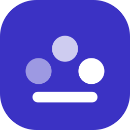

# 品牌与图标

## 产品标识（原创）

**Lookout（瞭望）**：一双队员的眼睛望向工作，下方一条底座（base）。眼睛与 Agent 头像「队员」用同一套原创造型（白色眼白 + 深色瞳孔 + 高光），瞳孔略偏右下，表示正在看手头的事。

| 项 | 规格 |
|---|---|
| 网格 | 32 × 32，圆角 9（网页 PWA / 触控图标为直角满版，由系统加遮罩） |
| 底色 | Crew Mint `#7FD8B4`（不与状态色混用：蓝 `#007CF7`、绿色「完成」点） |
| 图形 | 眼白 `#FFFFFF` r = 5.1，圆心 (10.6, 15)、(21.4, 15)；瞳孔 Ink `#1A1A1E` r = 2.5，圆心 (11.9, 15.7)、(22.7, 15.7)；高光白色 r = 0.8，圆心 (12.7, 14.8)、(23.5, 14.8)；底座 Ink 10 × 2.4，左上角 (11, 23.2)，圆角 1.2 |
| 菜单栏图标 | 去掉底色，图形画成黑色；瞳孔镂空（`data-tray="cut"`），高光不画（`data-tray="skip"`） |
| 最小尺寸 | 16 px |
| 源文件 | `docs/brand/crewbase-mark.svg`（唯一真源）、`apps/web/src/components/Logo.tsx`、`apps/web/index.html`（favicon、theme-color）、`apps/web/public/icon.svg`、`manifest.webmanifest`（theme_color） |
| 生成 | `go generate ./apps/desktop`：桌面 `resources/icon.png`、`assets/tray.png`，以及网页 `apps/web/public/icon-{180,192,512}.png` |

旧标识 Relay（接力，Crew Indigo `#3B32C4`）于 v0.3 之后停用。

## Agent 头像（原创）

「队员」：13 种形状（圆角方、圆、叶形、胶囊、菱形、六边形、三角、水滴、盾牌、八角、花、星芒、票券）× 18 种识别色，每个队员有一双圆眼睛——瞳孔跟着鼠标看、每隔几秒眨一下眼（每个 Agent 节奏不同）、按下时眯眼笑；悬停时轻轻扭一下，工作中轻微「呼吸」，等你时晃一晃，外观变化时弹一下。眼睛按底色亮度自动取深或浅；小于 24px 时眼睛不动。系统设置「减少动态效果」时全部静止。

眼睛的造型是我们自己的（圆形眼白 + 瞳孔 + 高光），不照搬其他产品的角色或吉祥物。状态以右下角圆点表示，识别色不与状态色混用。新对话没有人设，用中性的对话气泡图标。

## 模型厂商图标

厂商与模型来源使用 [LobeHub Icons](https://github.com/lobehub/lobe-icons)（MIT），通过 `@lobehub/icons-static-svg` 按需引入（`apps/web/src/components/ProviderMark.tsx`）。经网关（magpie、OpenRouter）的模型按模型 id 识别实际厂商；无法识别时显示中性字母标识，不自行仿制任何厂商标志或品牌色。

商标归各自所有者；图标仅用于标示模型来源。

## 原则

- 产品自身的标识、头像、插画一律原创，不复制或仿写其他产品（含 openbot、cindy 等）的 logo、吉祥物与标志性布局。
- 第三方图标只用于指代第三方本身，且遵循其许可证。
